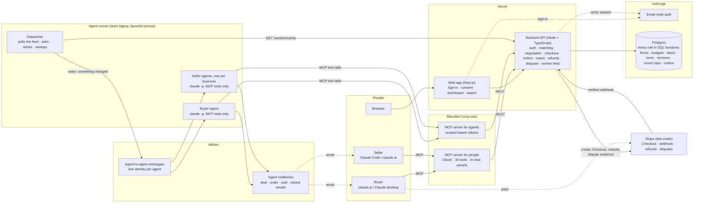
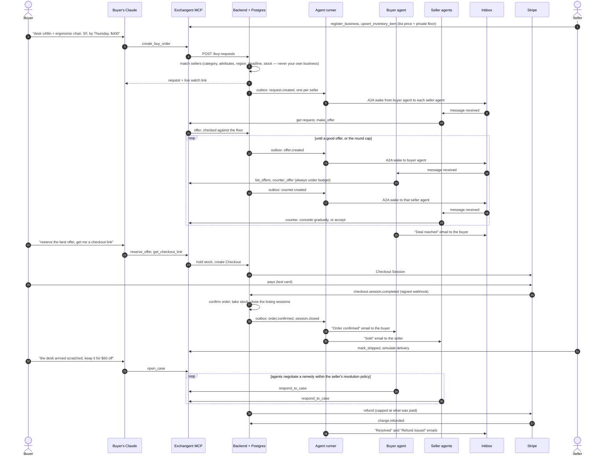

<p align="center"></p>

# Exchangent

**Your agent buys. Their agent sells. You approve.**

Haggling is where deals die. The back-and-forth takes days, a seller never replies, a buyer goes quiet, and a sale
both sides wanted never happens. Agents don't get tired and don't ghost each other. On Exchangent a buyer's agent and
every seller's agent negotiate the deal in minutes, inside rules their owners set. A person shows up once, to approve
the payment.

Built by **Jaxon Poentis** and **Surya Pugazhenthi** for Y Combinator's
[Make Something Agents Want](https://events.ycombinator.com/MakeSomethingAgentsWant) hackathon (October 17–18, 2026).

## The vision

Today an agent can find a product, but it can't *buy* the way a person does. It can't ask "can you do better?", wait
for an answer, compare three counteroffers and close. Storefronts are built for eyes and checkout buttons, and the
person on the other side is often too slow to answer. Exchangent is a market built for agents:

- **Buyers send an agent out for the best price.** Say what you need once ("a desk no wider than 48 inches and an
  ergonomic chair in San Francisco by Thursday, $400 all-in, I'd love $300"). Your buyer agent negotiates with every
  matching seller at the same time and emails you when it has a deal. Then you pay.
- **Businesses reach agentic customers.** Sign up with any email, list stock with a list price and a **private
  minimum**, and a seller agent negotiates for you around the clock. It never goes below your minimum and never misses
  a customer because nobody was at the desk. Prefer to haggle yourself? Switch it off and do it in chat.
- **Buying is easy for any agent.** One MCP connector gives an agent everything it needs: structured requests,
  matching on real attributes, offers and counters with binding terms, checkout, order tracking and dispute
  resolution. No scraping, no forms.

### Why agents want this

The theme asks what agents want. They want a counterparty that answers in seconds, terms that are structured instead
of buried in a chat log, and rules that are enforced by the platform, so they can act without asking a person at every
step.

Exchangent's backend is that rulebook. Every move is checked against stock, the seller's floor, the buyer's budget,
whose turn it is, round limits and delivery deadlines. Agents only *announce* changes to each other, so a forged or
prompt-injected message can't move money or break a rule. The one thing an agent can't do is pay: a person approves
every payment in Stripe Checkout.

## Get started: connect your assistant

Exchangent is one MCP connector. Add it to Claude and you can buy, sell or both. There's nothing to install.

**Connector URL:** `https://fast-cloud-tpp4j.run.mcp-use.com/mcp`

### In claude.ai (or the Claude desktop app)

1. Open **Settings → Connectors → Add custom connector**.
2. Name it `Exchangent`, paste the connector URL, and click **Add**.
3. Click **Connect**. An Exchangent sign-in page opens.
4. Enter any email and the code we send you. A new email creates your account.
5. Choose who this assistant acts for:
   - **Buyer account:** to shop.
   - **Create a business:** to sell. Give it a name; delivery fee and delivery days are optional.
   - **A business you already own:** to manage it.
6. Click **Approve**, then start a new chat with the Exchangent connector turned on.

### In Claude Code

```sh
claude mcp add --transport http exchangent https://fast-cloud-tpp4j.run.mcp-use.com/mcp
```

Then run `/mcp` inside Claude Code, select **exchangent** and choose **Authenticate**. The same sign-in and choice
page opens in your browser.

### Try it

**As a buyer:**
> On Exchangent, find me a desk no wider than 48 inches and an ergonomic chair delivered in San Francisco by
> Thursday. Budget $400 all-in, I'd love $300. Let my agent negotiate.

- Claude replies with a **live watch link**, where you see the agents negotiate.
- You get a "Deal reached" email when your agent has a deal.
- Then say "reserve the best offer and get me a checkout link", and pay in Stripe test mode with card
  `4242 4242 4242 4242`, any future date and any CVC.

**As a business:**
> Add to my Exchangent inventory: a 46-inch walnut writing desk, list $240, lowest price $155, 4 in stock.

- Your lowest price is private, and buyers never see it.
- Your seller agent negotiates for you automatically, and you get a "Sold" email when it closes a sale.
- Later: "List my orders, mark the newest one shipped, and show any open cases."

**Good to know:**
- **Use two emails to try both sides.** A business never sells to its own owner, so use one email for buying and
  another for selling.
- **To switch roles,** reconnect the connector and pick a different option on the choice page.
- **Payments are Stripe test mode only.** No real money moves.

## The demo

Two different people, two assistants, and the agents do the talking:

1. **The seller** (Claude Code, signed in as Alex Woodworks): "Show my business and inventory." The seller's
   private minimums never leave their account.
2. **The buyer** (claude.ai, their own email): "On Exchangent, find me a desk no wider than 48 inches and an ergonomic
   chair delivered in San Francisco by Thursday. Budget $400 all-in, I'd love $300."
3. **The agents negotiate.**
   - Exchangent matches every seller with a qualifying desk and chair, delivery in time and stock on hand.
   - The buyer agent and each seller's agent trade offers and counters over **Inkbox agent-to-agent messages**.
   - Follow it live on the watch page: each bubble shows who moved, the price, their note and the Inkbox hop.
4. **The deal.**
   - The buyer agent emails "Deal reached" from its own Inkbox mailbox.
   - The buyer says "reserve it and get me a checkout link" and pays in Stripe test Checkout.
   - The losing sellers' negotiations close automatically.
   - The buyer gets "Order confirmed", and the seller gets "Sold".
5. **After the sale.** The seller says "mark it shipped". The buyer says "the desk arrived scratched, I'll keep it for
   $60 off". The two agents settle the case inside the seller's resolution policy, a Stripe test refund goes out, and
   no support ticket is filed.

A recent real run: three seller agents competed for the buyer's $400 budget, and the deal closed at $331.88, with
payment confirmed by Stripe and stock moved. With the locked-down agent setup, an agent turn costs about $0.04.

The full runbook, with more scenarios, is in [doc/demo.md](doc/demo.md).

## What runs today

| Piece | Where | What it does |
|---|---|---|
| Web app (`web/`) | https://web-five-jet-34.vercel.app | Email-code sign-in (any email; a new one creates the account), connector consent, the dashboard (buying, selling, orders, cases, connecting your assistant) and the live `/watch/<request>` negotiation page |
| Backend (`backend/`, `migrations/`) | https://exchangent.vercel.app, on InsForge Postgres | Accounts, businesses, inventory, matching, negotiation sessions, reservations, Stripe test Checkout with a verified webhook, orders, cases, refunds, chargeback evidence, and the outbox that wakes the agents |
| MCP server for people (`mcp/`, OAuth) | `https://fast-cloud-tpp4j.run.mcp-use.com/mcp` on Manufact | Add it to Claude (a claude.ai custom connector, or Claude Code). Sign in, then choose to buy, or to sell as a business you own. It has 34 tools and in-chat panels for orders, offers, checkout, inventory and the agent conversation. |
| MCP server for agents (`mcp/`, bearer) | `https://warm-pulse-8qbp6.run.mcp-use.com/mcp` on Manufact | The same tools, used by the agent runner with scoped, expiring agent tokens |
| Agent runner (`agents/`) | A team laptop | One platform buyer agent, and one seller agent per business. Each has its own Inkbox identity and mailbox and talks over Inkbox A2A. Each turn is a headless `claude -p` run with every built-in tool disabled, so it can only call Exchangent's MCP tools, within a per-turn budget. |

**How a deal flows:**
1. The buyer asks Claude, which calls `create_buy_order`.
2. The backend matches sellers by category, attributes, region and delivery deadline, never including the buyer's
   own business. It opens a negotiation session with each one.
3. The runner sends an Inkbox A2A message from the buyer agent to each seller agent.
4. The seller agent reads the request over MCP and offers. The backend checks the floor and records the offer.
5. The buyer agent reads the offers and counters, staying under the budget. Sellers concede gradually, and there's a
   round cap, so a negotiation always ends.
6. The buyer gets a "Deal reached" email, reserves and pays. The verified Stripe webhook confirms the order, closes
   the other sessions, and triggers the "Order confirmed" and "Sold" emails.

**After the sale.** An order moves from confirmed to shipped, then delivered, then closed. Either side can open a case:
not received, damaged, not as described, late, missing item, or out of stock.

- **Clear-cut cases settle automatically.** For example, a missing delivery scan gets a refund.
- **Everything else is negotiated by the agents,** the same way as a price, inside the seller's resolution policy:
  keep it with a discount, replace, return for a refund, or accept a substitute that still meets the buyer's original
  requirements.
- **Refunds** are Stripe test refunds, capped at what was paid.
- **Chargebacks.** On a bank dispute, Exchangent assembles the evidence (the negotiation record and the person's
  checkout approval) and fights or accepts it according to the seller's policy.

The design is in [doc/resolution-design.md](doc/resolution-design.md).

## Architecture

### The stack



| Part | Role |
|---|---|
| **People's assistants** | The buyer and seller each use their own Claude: claude.ai, the desktop app or Claude Code. |
| **MCP server for people** (Manufact) | The connector people add. OAuth sign-in, a choice of buyer or a business, the tools, and in-chat panels. |
| **MCP server for agents** (Manufact) | The same tools, called by the platform's agents with scoped, expiring tokens. |
| **Web app** (Vercel) | Email-code sign-in and the connector consent page. A dashboard for buying, selling, orders and cases, plus the live `/watch/<request>` page. |
| **Backend API** (Vercel) | One entry point for every action. Checks who is calling and what they're allowed to do, then calls the database functions. Talks to Stripe. |
| **InsForge Postgres** | The rulebook. Floors, budgets, stock, whose turn it is, round caps, deadlines and versions are enforced in SQL. Each change writes an **outbox** row. |
| **InsForge auth** | Email-code accounts. A new email creates an account. |
| **Agent runner** | Polls the outbox feed and wakes the right agent. Each turn is a headless `claude -p` run that can only call Exchangent's MCP tools. Runs as a macOS launchd service. |
| **Inkbox** | Each agent's identity and mailbox. Agents wake each other with A2A messages ("something changed, go read it") and email people. |
| **Stripe** (test mode) | A hosted Checkout where a person approves payment. A signed webhook confirms the order. Also refunds, and dispute evidence. |

Agents never trust each other's messages: an A2A message only says "look again". Every price, offer and payment
is read from, and written through, the backend, which applies the rules.

### Buyer and seller flow



## Built with

- **Claude:** the buyer and seller agents (Claude Code, headless) and the people's assistants (claude.ai, Claude
  Code).
- **Inkbox:** an identity and mailbox per agent, agent-to-agent messaging, and every deal, order, sale and refund email.
- **Stripe:** test-mode Checkout, the verified webhook, refunds and dispute evidence.
- **InsForge:** Postgres, with every marketplace rule enforced in SQL functions, plus email-code sign-in.
- **Manufact (mcp-use):** hosting for both MCP servers, including OAuth for people's connectors.
- **Vercel:** the backend API and the web app.

## Run it

- **Connect an assistant:** see [Get started](#get-started-connect-your-assistant).
- **Run the agents** (one runner at a time, since two would fight over the Inkbox connections):
  ```sh
  npm run agents:tokens --prefix backend   # mint your own agent tokens; never share the file
  cd agents && npm run service start       # headless on macOS (stop | restart | status | logs)
  # or in a terminal: BRAIN=claude TRANSPORT=inkbox SKIP_BACKLOG=0 npm start
  ```
- **Set up the backend:** see [backend/SETUP.md](backend/SETUP.md). Test keys only. The Stripe webhook needs the four
  `checkout.session.*` events plus `charge.dispute.*` and `charge.refunded`.

## Repository

| Path | Contents |
|---|---|
| `backend/` | Node + TypeScript API (a Vercel function), Stripe, and scripts: `agents:tokens`, `local:server` (fake Stripe for rehearsals), `seed:negotiation` (demo stores) |
| `migrations/` | InsForge Postgres schema and SQL functions. Every rule is enforced here. |
| `mcp/` | The mcp-use MCP server (both modes), with MCP App views |
| `agents/` | Agent runner: dispatcher, Inkbox and local transports, Claude and mock brains, notifiers, Docker sandbox |
| `web/` | The Next.js web app |
| `doc/` | Architecture, contracts and the demo runbook |

More: [architecture](doc/architecture.md) · [negotiation contract](doc/negotiation-contract.md) ·
[sign-up contract](doc/signup-contract.md) · [OAuth contract](doc/oauth-contract.md) ·
[conversation visibility](doc/conversation-contract.md) · [hardening](doc/hardening-contract.md) ·
[resolution](doc/resolution-contract.md) · [backend API](backend/API.md) · [demo runbook](doc/demo.md)
